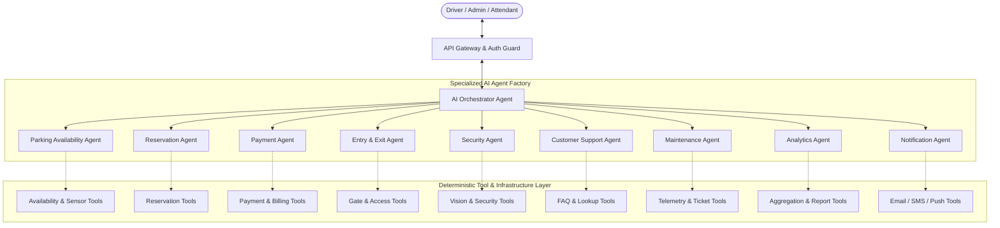
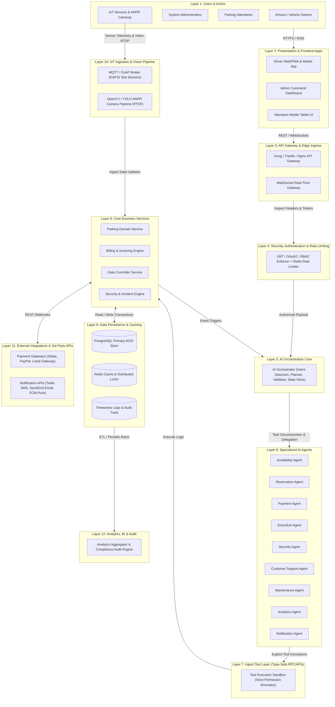
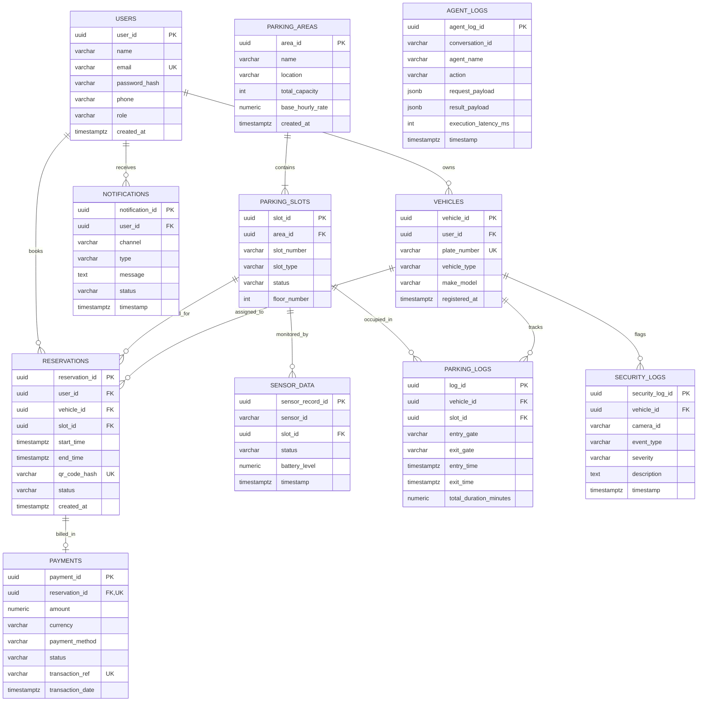
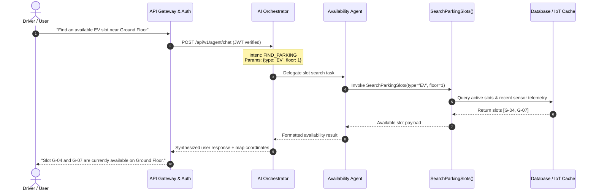
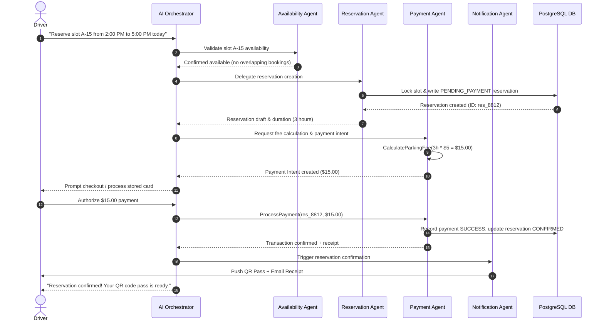
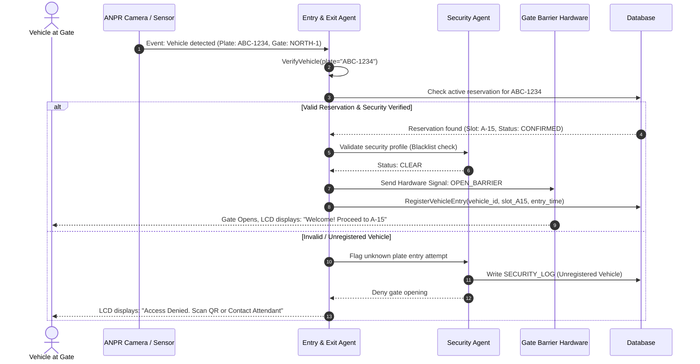
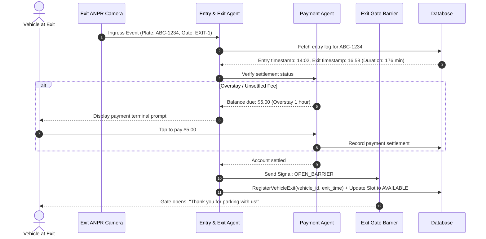
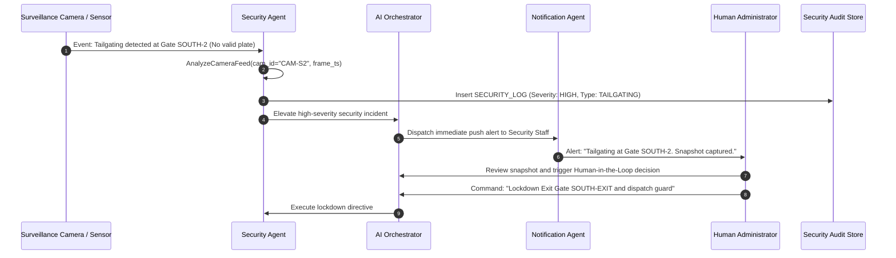
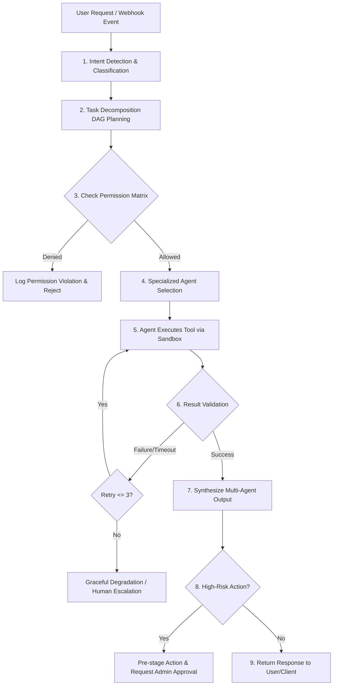
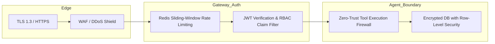

# PARKING SYSTEM AGENTIC AI FACTORY
## Comprehensive System Design Specification & Technical Architecture
**Project Type:** BSCS Capstone / Enterprise Agentic AI Thesis System  
**Version:** 1.0.0 (Authoritative Cleaned Specification)  
**Date:** September 2026  

---

## 1. Executive Summary & System Overview

The **Parking System Agentic AI Factory** is an intelligent, multi-agent automated parking management platform. Unlike conventional chatbot overlays or static CRUD systems, this platform implements a true **Agentic AI Factory Architecture**: a centralized **AI Orchestrator** dynamically plans, delegates, monitors, and validates tasks across **10 specialized AI agents**.

Each agent operates under strict, least-privilege tool execution permissions, coordinating real-time IoT sensors, computer vision (ANPR/ALPR), automated billing, gate telemetry, security monitoring, and predictive analytics.

### Core System Components
1. **Driver Web & Mobile Application:** Real-time slot search, live navigation, reservation management, dynamic QR access pass, in-app payment, and conversational AI assistance.
2. **Admin Command Dashboard:** Facility topology builder, multi-agent telemetry monitor, dynamic pricing engine, security incident triage, human-in-the-loop review console, and financial reporting.
3. **Parking Attendant Mobile/Tablet Interface:** Manual license plate lookup, manual barrier override with audit logging, assigned slot validation, and on-ground ticket issuance.
4. **API Gateway & Event Bus:** Unified entry point routing HTTP/REST, WebSocket streams, and internal message queues with JWT authentication, rate limiting, and request validation.
5. **Agentic AI Factory (Orchestrator + 10 Specialized Agents):** State-machine driven LLM orchestrator enforcing structured function-calling and strict permission scoping.
6. **Agent Tool Layer:** Deterministic, type-safe API bridges connecting agents to business logic and hardware.
7. **IoT Sensor & Vision Pipeline:** ESP32 ultrasonic/magnetic slot sensors and RTSP/WebRTC OpenCV/YOLO ANPR camera streams.
8. **Relational Database & Timeseries Store:** PostgreSQL for transactional ACID integrity with timeseries partitioning for sensor telemetry and security audit logs.

---

## 2. Agent Architecture & Agent Responsibilities Matrix



### Agent Responsibilities Matrix

| Agent Name | Core Domain & Objectives | Input Triggers | Delegated Outputs / Actions |
| :--- | :--- | :--- | :--- |
| **AI Orchestrator Agent** | Central coordinator; intent detection; multi-step DAG planning; state synchronization; agent delegation; validation; error recovery; human escalation. | User natural language prompts, system webhooks, API requests | Dispatched sub-tasks to agents; aggregated JSON responses; escalation triggers |
| **Parking Availability Agent** | Real-time slot occupancy tracking, sensor aggregation, zone status, live inventory computation. | Orchestrator query, sensor state change event | Real-time available slots, occupancy maps, floor-wise stats |
| **Reservation Agent** | Slot reservation lifecycle (creation, modification, cancellation, auto-expiry, conflict resolution). | Orchestrator intent, timer expiry triggers | Confirmed bookings, digital QR tokens, reservation status |
| **Payment Agent** | Dynamic fee calculation, payment processing, invoice/receipt generation, refund workflows, transaction verification. | Reservation checkout, exit gate trigger | Payment intent, gateway charge verification, signed receipt |
| **Entry & Exit Agent** | Vehicle ingress/egress validation, QR verification, ANPR barrier automation, duration calculation. | Ingress/Egress camera/sensor events | Gate actuation commands (`OPEN_GATE`), parking log entries |
| **Security Agent** | ALPR plate cross-referencing, unauthorized stay detection, tailgating flags, blacklisted vehicle alerts. | Camera feeds, ANPR match failure, entry without booking | Security alert generation, admin escalation, incident logs |
| **Customer Support Agent** | Conversational assistance, policy/tariff explanations, booking troubleshooting, sentiment-aware guidance. | End-user chat inquiries | Contextual plain-text responses, guided booking assistance |
| **Maintenance Agent** | Hardware health monitoring (sensors, gates, cameras), anomaly detection, automated ticketing. | Sensor offline heartbeat, repeated gate timeout | Work orders / maintenance tickets, slot disabled flags |
| **Analytics Agent** | Occupancy trends, revenue forecasting, peak-period modeling, utilization reports for management. | Admin reporting queries, scheduled cron jobs | Chart data, aggregated metrics, revenue CSV/PDF reports |
| **Notification Agent** | Asynchronous dispatch of multichannel alerts (Email, SMS, Push, WhatsApp). | Agent event emissions (Booking, Payment, Alert) | Dispatch receipts, deliverability logs, retry status |

---

## 3. Authoritative Unified System Architecture (12 Layers)



---

## 4. Agent-to-Tool Permission Matrix & Tool Specifications

> **Core Architectural Rule:** The AI Orchestrator **never** calls business or database tools directly. It evaluates user intent and delegates tasks strictly to specialized agents. Each tool enforces role-based, least-privilege verification before execution.

| Tool Name | Parameters | Availability Agent | Reservation Agent | Payment Agent | Entry & Exit Agent | Security Agent | Customer Support Agent | Maintenance Agent | Analytics Agent | Notification Agent |
| :--- | :--- | :---: | :---: | :---: | :---: | :---: | :---: | :---: | :---: | :---: |
| `SearchParkingSlots()` | `(area_id, slot_type, start_time, end_time)` |  |  |  |  |  |  |  |  |  |
| `CheckSlotAvailability()` | `(slot_id, timestamp)` |  |  |  |  |  |  |  |  |  |
| `ReserveParkingSlot()` | `(user_id, vehicle_id, slot_id, start_time, end_time)` |  |  |  |  |  |  |  |  |  |
| `CancelReservation()` | `(reservation_id, user_id, reason)` |  |  |  |  |  |  |  |  |  |
| `CalculateParkingFee()` | `(slot_type, duration_minutes, is_peak)` |  |  |  |  |  |  |  |  |  |
| `ProcessPayment()` | `(reservation_id, amount, payment_method, token)` |  |  |  |  |  |  |  |  |  |
| `VerifyPayment()` | `(payment_id)` |  |  |  |  |  |  |  |  |  |
| `GenerateReceipt()` | `(payment_id)` |  |  |  |  |  |  |  |  |  |
| `RegisterVehicleEntry()` | `(vehicle_id, slot_id, entry_gate_id)` |  |  |  |  |  |  |  |  |  |
| `RegisterVehicleExit()` | `(vehicle_id, exit_gate_id)` |  |  |  |  |  |  |  |  |  |
| `VerifyQRCode()` | `(qr_token, gate_id)` |  |  |  |  |  |  |  |  |  |
| `VerifyVehicle()` | `(plate_number, gate_id)` |  |  |  |  |  |  |  |  |  |
| `ReadParkingSensor()` | `(sensor_id)` |  |  |  |  |  |  |  |  |  |
| `AnalyzeCameraFeed()` | `(camera_id, frame_timestamp)` |  |  |  |  |  |  |  |  |  |
| `SendNotification()` | `(user_id, channel, template_id, payload)` |  |  |  |  |  |  |  |  |  |
| `CreateMaintenanceTicket()` | `(device_id, device_type, issue_code, severity)` |  |  |  |  |  |  |  |  |  |
| `GenerateParkingReport()` | `(area_id, start_date, end_date, metrics)` |  |  |  |  |  |  |  |  |  |

---

## 5. Complete Relational Database Schema & ERD

### Database Entity-Relationship Diagram (ERD)



### PostgreSQL DDL Schema Implementation

```sql
-- Enable UUID extension
CREATE EXTENSION IF NOT EXISTS "uuid-ossp";

-- Enum types for data integrity
CREATE TYPE user_role AS ENUM ('DRIVER', 'ADMIN', 'ATTENDANT', 'SECURITY_OFFICER');
CREATE TYPE vehicle_type AS ENUM ('COMPACT', 'SEDAN', 'SUV', 'EV', 'MOTORCYCLE', 'ACCESSIBLE');
CREATE TYPE slot_status AS ENUM ('AVAILABLE', 'OCCUPIED', 'RESERVED', 'MAINTENANCE', 'DISABLED');
CREATE TYPE reservation_status AS ENUM ('PENDING_PAYMENT', 'CONFIRMED', 'ACTIVE', 'COMPLETED', 'CANCELLED', 'EXPIRED');
CREATE TYPE payment_status AS ENUM ('INITIATED', 'SUCCEEDED', 'FAILED', 'REFUNDED');
CREATE TYPE security_severity AS ENUM ('INFO', 'LOW', 'MEDIUM', 'HIGH', 'CRITICAL');

-- 1. USERS Table
CREATE TABLE users (
    user_id UUID PRIMARY KEY DEFAULT uuid_generate_v4(),
    name VARCHAR(100) NOT NULL,
    email VARCHAR(150) UNIQUE NOT NULL,
    password_hash VARCHAR(255) NOT NULL,
    phone VARCHAR(20),
    role user_role NOT NULL DEFAULT 'DRIVER',
    created_at TIMESTAMPTZ NOT NULL DEFAULT CURRENT_TIMESTAMP,
    updated_at TIMESTAMPTZ NOT NULL DEFAULT CURRENT_TIMESTAMP
);

-- 2. VEHICLES Table
CREATE TABLE vehicles (
    vehicle_id UUID PRIMARY KEY DEFAULT uuid_generate_v4(),
    user_id UUID NOT NULL REFERENCES users(user_id) ON DELETE CASCADE,
    plate_number VARCHAR(20) UNIQUE NOT NULL,
    vehicle_type vehicle_type NOT NULL DEFAULT 'SEDAN',
    make_model VARCHAR(100),
    registered_at TIMESTAMPTZ NOT NULL DEFAULT CURRENT_TIMESTAMP
);

-- 3. PARKING_AREAS Table
CREATE TABLE parking_areas (
    area_id UUID PRIMARY KEY DEFAULT uuid_generate_v4(),
    name VARCHAR(100) NOT NULL,
    location TEXT NOT NULL,
    total_capacity INT NOT NULL CHECK (total_capacity > 0),
    base_hourly_rate NUMERIC(10, 2) NOT NULL CHECK (base_hourly_rate >= 0),
    created_at TIMESTAMPTZ NOT NULL DEFAULT CURRENT_TIMESTAMP
);

-- 4. PARKING_SLOTS Table
CREATE TABLE parking_slots (
    slot_id UUID PRIMARY KEY DEFAULT uuid_generate_v4(),
    area_id UUID NOT NULL REFERENCES parking_areas(area_id) ON DELETE CASCADE,
    slot_number VARCHAR(20) NOT NULL,
    slot_type vehicle_type NOT NULL DEFAULT 'SEDAN',
    floor_number INT NOT NULL DEFAULT 1,
    status slot_status NOT NULL DEFAULT 'AVAILABLE',
    UNIQUE (area_id, slot_number)
);

-- 5. RESERVATIONS Table
CREATE TABLE reservations (
    reservation_id UUID PRIMARY KEY DEFAULT uuid_generate_v4(),
    user_id UUID NOT NULL REFERENCES users(user_id) ON DELETE RESTRICT,
    vehicle_id UUID NOT NULL REFERENCES vehicles(vehicle_id) ON DELETE RESTRICT,
    slot_id UUID NOT NULL REFERENCES parking_slots(slot_id) ON DELETE RESTRICT,
    start_time TIMESTAMPTZ NOT NULL,
    end_time TIMESTAMPTZ NOT NULL,
    qr_code_hash VARCHAR(64) UNIQUE NOT NULL,
    status reservation_status NOT NULL DEFAULT 'PENDING_PAYMENT',
    created_at TIMESTAMPTZ NOT NULL DEFAULT CURRENT_TIMESTAMP,
    CHECK (end_time > start_time)
);

-- 6. PAYMENTS Table
CREATE TABLE payments (
    payment_id UUID PRIMARY KEY DEFAULT uuid_generate_v4(),
    reservation_id UUID UNIQUE NOT NULL REFERENCES reservations(reservation_id) ON DELETE RESTRICT,
    amount NUMERIC(10, 2) NOT NULL CHECK (amount >= 0),
    currency VARCHAR(3) NOT NULL DEFAULT 'USD',
    payment_method VARCHAR(50) NOT NULL,
    status payment_status NOT NULL DEFAULT 'INITIATED',
    transaction_ref VARCHAR(100) UNIQUE,
    transaction_date TIMESTAMPTZ NOT NULL DEFAULT CURRENT_TIMESTAMP
);

-- 7. PARKING_LOGS Table
CREATE TABLE parking_logs (
    log_id UUID PRIMARY KEY DEFAULT uuid_generate_v4(),
    vehicle_id UUID NOT NULL REFERENCES vehicles(vehicle_id) ON DELETE CASCADE,
    slot_id UUID NOT NULL REFERENCES parking_slots(slot_id) ON DELETE SET NULL,
    entry_gate VARCHAR(50) NOT NULL,
    exit_gate VARCHAR(50),
    entry_time TIMESTAMPTZ NOT NULL DEFAULT CURRENT_TIMESTAMP,
    exit_time TIMESTAMPTZ,
    total_duration_minutes NUMERIC(10, 2)
);

-- 8. SENSOR_DATA Table
CREATE TABLE sensor_data (
    sensor_record_id UUID PRIMARY KEY DEFAULT uuid_generate_v4(),
    sensor_id VARCHAR(50) NOT NULL,
    slot_id UUID NOT NULL REFERENCES parking_slots(slot_id) ON DELETE CASCADE,
    status slot_status NOT NULL,
    battery_level NUMERIC(4, 2),
    timestamp TIMESTAMPTZ NOT NULL DEFAULT CURRENT_TIMESTAMP
);

-- 9. SECURITY_LOGS Table
CREATE TABLE security_logs (
    security_log_id UUID PRIMARY KEY DEFAULT uuid_generate_v4(),
    vehicle_id UUID REFERENCES vehicles(vehicle_id) ON DELETE SET NULL,
    camera_id VARCHAR(50),
    event_type VARCHAR(50) NOT NULL,
    severity security_severity NOT NULL DEFAULT 'LOW',
    description TEXT NOT NULL,
    timestamp TIMESTAMPTZ NOT NULL DEFAULT CURRENT_TIMESTAMP
);

-- 10. AGENT_LOGS Table
CREATE TABLE agent_logs (
    agent_log_id UUID PRIMARY KEY DEFAULT uuid_generate_v4(),
    conversation_id VARCHAR(100),
    agent_name VARCHAR(50) NOT NULL,
    action VARCHAR(100) NOT NULL,
    request_payload JSONB,
    result_payload JSONB,
    execution_latency_ms INT,
    timestamp TIMESTAMPTZ NOT NULL DEFAULT CURRENT_TIMESTAMP
);

-- 11. NOTIFICATIONS Table
CREATE TABLE notifications (
    notification_id UUID PRIMARY KEY DEFAULT uuid_generate_v4(),
    user_id UUID NOT NULL REFERENCES users(user_id) ON DELETE CASCADE,
    channel VARCHAR(20) NOT NULL, -- EMAIL, SMS, PUSH
    type VARCHAR(50) NOT NULL,
    message TEXT NOT NULL,
    status VARCHAR(20) NOT NULL DEFAULT 'SENT',
    timestamp TIMESTAMPTZ NOT NULL DEFAULT CURRENT_TIMESTAMP
);

-- Essential Performance Indexes
CREATE INDEX idx_parking_slots_area_status ON parking_slots(area_id, status);
CREATE INDEX idx_reservations_user_dates ON reservations(user_id, start_time, end_time);
CREATE INDEX idx_sensor_data_slot_ts ON sensor_data(slot_id, timestamp DESC);
CREATE INDEX idx_parking_logs_vehicle_entry ON parking_logs(vehicle_id, entry_time);
CREATE INDEX idx_agent_logs_conv ON agent_logs(conversation_id, timestamp);
```

---

## 6. End-to-End Agent Workflows (A – E)

### Workflow A: Find Parking Slot


### Workflow B: Reserve Parking Slot & Complete Payment


### Workflow C: Automated Vehicle Entry


### Workflow D: Automated Vehicle Exit


### Workflow E: Security Alert & Incident Triage


---

## 7. AI Decision-Making, Task Decomposition & Governance



### Governance Principles
1. **Zero Direct Database Access for Orchestrator:** The Orchestrator constructs plans and delegates. It cannot invoke database mutating tools directly.
2. **Deterministic Schema Enforcement:** All tool invocations use strictly validated JSON Schema (Pydantic / Zod models).
3. **Loop & Token Caps:** Maximum 5 iterative sub-agent hops per user prompt to prevent cyclic reasoning locks.

---

## 8. Human-in-the-Loop (HITL) Safety Architecture

High-risk actions cannot be executed autonomously by any AI agent. Instead, the agent creates a **Pre-staged Staging Record** in the database and requests explicit human administrative sign-off:

| High-Risk Operation | Requesting Agent | Reason for HITL Policy | Approval Mechanism |
| :--- | :--- | :--- | :--- |
| **Financial Refunds** | Payment Agent | Prevents fraudulent automated charge reversals | Admin 2FA Token Approval |
| **User Account Suspension** | Security Agent | Prevents erroneous account lockouts | Admin Dashboard Review |
| **Security Gate Lockdown** | Security Agent | Physical safety and fire code compliance | On-duty Attendant/Admin physical key/button override |
| **Manual Reservation Override** | Reservation Agent | Prevents unauthorized space assignment | Attendant Role PIN |
| **Sensor Calibration Override** | Maintenance Agent | Avoids false occupancy broadcasts | Engineering Staff Approval |

---

## 9. Security Architecture & Threat Model



### Security Safeguards
1. **Authentication:** Argon2id / bcrypt password hashing with PBKDF2 fallback; stateless RS256 signed JWT tokens with short expiry (15 min) and rotating refresh tokens.
2. **Zero-Trust Tool Scoping:** Agents authenticate to the Tool Layer via cryptographically signed sub-tokens containing explicit tool execution claims.
3. **Data Protection:** AES-256 encryption at rest for database volumes; TLS 1.3 in transit; PCI-DSS Level 4 compliance model with tokenized card handling (no raw PAN in database).
4. **Audit Logging:** Immutable `AGENT_LOGS` and `SECURITY_LOGS` append-only tables tracking all prompt tokens, tool inputs, latency, and outputs.

---

## 10. Technology Stack & Trade-off Analysis

| Layer | Recommended Choice | Rationale | Production Alternative |
| :--- | :--- | :--- | :--- |
| **Frontend** | **Next.js 14 (React, TypeScript, TailwindCSS)** | Server-side rendering (SSR) for SEO, App Router for fast UI transitions, native WebSocket support, unified TypeScript type-sharing. | React + Vite SPA, Flutter (Mobile) |
| **Backend & API** | **Node.js (NestJS / Express) + Python FastAPI** | NestJS provides enterprise modularity and dependency injection for business logic; FastAPI provides high-speed asynchronous inference for Computer Vision & AI Agent loops. | Go (Golang) Gin, Django REST Framework |
| **Agent Core** | **LangChain / LangGraph + Gemini 1.5/2.0 Pro / GPT-4o** | Graph-based state machine (LangGraph) enforces strict agent handoffs, cyclical loops, and deterministic schema validation. | AutoGen, CrewAI, Raw OpenAI/Gemini SDK |
| **Database** | **PostgreSQL 16 + PostGIS + TimescaleDB** | Rock-solid ACID transactions for financial reservations; spatial indexing for parking slots; timeseries partitioning for sensor logs. | MySQL 8.0, MongoDB |
| **Real-time Sync** | **WebSockets (Socket.io) + Redis Pub/Sub** | Sub-50ms live slot status updates on UI maps and instantaneous gate sensor event streaming. | MQTT Broker, Apache Kafka |
| **Computer Vision** | **OpenCV + YOLOv8 (Ultralytics) + PaddleOCR** | High-accuracy real-time license plate recognition (ANPR) and barrier vehicle detection at 30+ FPS on edge GPU. | Amazon Rekognition, OpenALPR |
| **IoT Telemetry** | **MQTT Broker (Eclipse Mosquitto / EMQX)** | Lightweight publish/subscribe protocol ideal for low-power ESP32 ultrasonic slot sensors over WiFi/LoRa. | HTTP Webhooks, CoAP |
| **Containers** | **Docker & Docker Compose** | Reproducible multi-service deployment with isolated networking for database, backend, AI agents, and frontend. | Kubernetes (K8s) |

---

## 11. Complete Project Directory Structure

```
parking-ai-factory/
├── .github/                      # CI/CD Workflows & automated testing
├── docker/
│   ├── docker-compose.yml       # Multi-service stack (DB, Redis, Backend, Agents, UI)
│   ├── Dockerfile.frontend
│   ├── Dockerfile.backend
│   └── Dockerfile.ai_agents
├── frontend/                     # Next.js 14 Driver & Admin Application
│   ├── public/
│   ├── src/
│   │   ├── app/                 # Next.js App Router (Driver, Admin, Attendant)
│   │   ├── components/          # Reusable UI (SlotMap, LiveFeed, QRPass, ChatModal)
│   │   ├── hooks/               # Custom React hooks (useWebSocket, useParkingSlots)
│   │   ├── lib/                 # API clients, auth helpers, formatting
│   │   └── types/               # TypeScript interfaces & DTOs
│   ├── package.json
│   └── tsconfig.json
├── backend/                      # NestJS / Express Core Business Logic
│   ├── src/
│   │   ├── auth/                # JWT strategy, password hashing, RBAC guards
│   │   ├── parking/             # Slot allocation, areas, occupancy calculation
│   │   ├── reservations/        # Booking lifecycle, conflict checks, QR hashing
│   │   ├── payments/            # Stripe integration, receipt generation
│   │   ├── gate/                # Gate hardware telemetry & access logic
│   │   ├── websocket/           # Live slot status broadcast gateway
│   │   └── main.ts
│   ├── package.json
│   └── tsconfig.json
├── agents/                       # Agentic AI Factory Layer
│   ├── orchestrator/            # Intent classification, DAG planning, state store
│   ├── availability/            # Real-time slot availability agent
│   ├── reservation/             # Booking & conflict agent
│   ├── payment/                 # Invoicing & checkout agent
│   ├── entry_exit/              # ANPR validation & barrier agent
│   ├── security/                # Anomaly detection & threat agent
│   ├── support/                 # Customer support & FAQ agent
│   ├── maintenance/             # Device health & ticketing agent
│   ├── analytics/               # Metrics, forecasting & BI agent
│   ├── notification/            # Multichannel dispatch agent
│   └── agent_runtime.py         # LangGraph execution loop & governance
├── tools/                        # Deterministic Tool Implementations
│   ├── availability_tools.py    # SearchParkingSlots, CheckSlotAvailability
│   ├── reservation_tools.py     # ReserveParkingSlot, CancelReservation
│   ├── payment_tools.py         # ProcessPayment, VerifyPayment, GenerateReceipt
│   ├── gate_tools.py            # RegisterVehicleEntry, VerifyQRCode
│   ├── security_tools.py        # VerifyVehicle, AnalyzeCameraFeed
│   ├── maintenance_tools.py     # CreateMaintenanceTicket, ReadParkingSensor
│   └── notification_tools.py    # SendNotification
├── database/                     # PostgreSQL Migrations & Seeds
│   ├── migrations/              # DDL schema SQL files
│   ├── seeds/                   # Mock parking areas, slots, and demo users
│   └── db_connection.py
├── sensors/                      # IoT Hardware Code
│   ├── esp32_firmware/          # C++/Arduino ultrasonic sensor code
│   └── mqtt_publisher.py        # Telemetry ingestion daemon
├── computer_vision/              # OpenCV & YOLO ANPR Pipeline
│   ├── anpr_engine.py           # License plate localization & OCR
│   ├── vehicle_tracker.py       # Centroid tracking & gate zone triggers
│   └── models/                  # YOLOv8 weights
├── tests/                        # Comprehensive Test Suites
│   ├── unit/                    # Tool tests & unit logic
│   ├── integration/             # Agent orchestration tests
│   ├── e2e/                     # End-to-end booking & entry simulations
│   └── load/                    # Locust load testing for slot concurrency
├── documentation/                # Architecture diagrams & capstone thesis documents
│   └── PARKING_SYSTEM_AGENTIC_AI_FACTORY_SPEC.md
└── README.md
```

---

## 12. 10-Phase Development Roadmap

| Phase | Phase Name | Deliverables & Features | Database Updates | AI Agents / Tools Involved | Testing Milestone |
| :--- | :--- | :--- | :--- | :--- | :--- |
| **Phase 1** | **Core Parking CRUD** | Parking areas, slot modeling, slot status management, admin CRUD UI. | `users`, `parking_areas`, `parking_slots` | None (Deterministic Services) | Unit test slot allocation & constraints |
| **Phase 2** | **Reservation & Payments** | Booking calendar, conflict locking, Stripe sandbox, QR pass generator. | `reservations`, `payments` | None | Concurrency double-booking stress tests |
| **Phase 3** | **AI Customer Support** | Conversational chat interface for slot FAQ, pricing, and booking help. | `agent_logs` | Customer Support Agent | Prompt evaluation & benchmark QA tests |
| **Phase 4** | **AI Orchestrator Engine** | LLM planner, multi-turn state machine, DAG task decomposition. | `agent_logs` (schema expansion) | AI Orchestrator Core | Intent classification benchmark (>95% accuracy) |
| **Phase 5** | **Specialized Agents & Tools** | Full tool layer sandbox, permission matrix enforcement, agent isolation. | All tables | Availability, Reservation, Payment Agents | Multi-agent collaboration integration tests |
| **Phase 6** | **IoT Sensor Integration** | MQTT broker, ESP32 slot sensors, real-time WebSocket map status sync. | `sensor_data` | Maintenance Agent, `ReadParkingSensor()` | Hardware simulation loop (100 concurrent sensors) |
| **Phase 7** | **Computer Vision & ANPR** | RTSP camera ingestion, YOLO vehicle detection, PaddleOCR license reading. | `security_logs`, `parking_logs` | Entry & Exit Agent, Security Agent | ANPR accuracy test on 500 test plate images |
| **Phase 8** | **Analytics & Reporting** | Occupancy heatmaps, dynamic pricing recommendations, revenue charts. | Analytics materialized views | Analytics Agent, `GenerateParkingReport()` | Aggregation performance (<200ms query time) |
| **Phase 9** | **Security Hardening & HITL** | Human-in-the-loop admin portal, zero-trust tokens, rate limiting. | `security_logs` | Security Agent | Security penetration testing & OWASP audit |
| **Phase 10** | **Deployment & Production** | Docker Compose orchestration, CI/CD pipeline, performance monitoring. | Production DB indexing & backups | All Agents & Services | E2E system integration & chaos testing |

---

## 13. Example Multi-Turn Agent Conversations & Execution Traces

### Conversational Trace: Intelligent Reservation
**User:** *"Hi! I have a client meeting from 3 PM to 6 PM. Is there any executive slot available on Floor 2, and can you book it for my Audi plate NY-8821?"*

```json
{
  "trace_id": "trc_9981a2f4",
  "step_1_orchestrator_planning": {
    "detected_intent": "RESERVE_PARKING",
    "extracted_entities": {
      "start_time": "2026-09-26T15:00:00Z",
      "end_time": "2026-09-26T18:00:00Z",
      "floor": 2,
      "slot_type": "SEDAN",
      "plate_number": "NY-8821"
    },
    "execution_dag": [
      {"step": 1, "agent": "AvailabilityAgent", "action": "CheckFloorAvailability"},
      {"step": 2, "agent": "ReservationAgent", "action": "CreateDraftReservation"},
      {"step": 3, "agent": "PaymentAgent", "action": "CalculateFeeAndPaymentIntent"},
      {"step": 4, "agent": "NotificationAgent", "action": "SendConfirmation"}
    ]
  },
  "step_2_availability_agent_execution": {
    "tool_invoked": "SearchParkingSlots(area_id='main_garage', floor=2, slot_type='SEDAN')",
    "tool_result": {
      "matching_slots": ["F2-04", "F2-09"],
      "recommended_slot": "F2-04"
    }
  },
  "step_3_payment_agent_execution": {
    "tool_invoked": "CalculateParkingFee(duration_hours=3, rate_per_hour=6.00)",
    "tool_result": {
      "base_amount": 18.00,
      "tax": 1.44,
      "total_amount": 19.44,
      "currency": "USD"
    }
  },
  "step_4_orchestrator_response_to_user": {
    "message": "Slot **F2-04** on Floor 2 is available for your Audi (NY-8821) from 3:00 PM to 6:00 PM. The total fee for 3 hours is **$19.44**. Would you like me to charge your saved Visa ending in 4022 and confirm the reservation?"
  }
}
```

---

## 14. Core REST API & WebSocket Specifications

### Ingress Endpoints
1. `POST /api/v1/auth/login` — Authenticate user and issue signed JWT.
2. `POST /api/v1/orchestrator/chat` — Submit natural language request to Agentic AI Factory.
3. `GET /api/v1/parking/slots?floor=1&status=AVAILABLE` — Real-time slot status list.
4. `POST /api/v1/reservations` — Direct booking creation.
5. `POST /api/v1/gate/anpr-event` — Ingestion endpoint for RTSP camera ANPR triggers.
6. `WS /api/v1/ws/parking-stream` — Real-time duplex WebSocket for live slot occupancy maps.

---

## 15. Testing & Validation Strategy

```
                          ┌──────────────────────────┐
                          │   E2E Multi-Agent Tests  │  (5% of tests)
                          ├──────────────────────────┤
                          │  Agent Collaboration &   │
                          │     Integration Tests    │  (25% of tests)
                          ├──────────────────────────┤
                          │ Hardware & ANPR Mocking  │  (30% of tests)
                          ├──────────────────────────┤
                          │ Deterministic Unit Tests │  (40% of tests)
                          │   (Tools, Schema, Math)  │
                          └──────────────────────────┘
```

1. **Deterministic Unit Tests:** 100% coverage on `CalculateParkingFee`, date overlap validators, and schema models.
2. **Tool Execution Sandboxing:** Verify that if `CustomerSupportAgent` attempts to call `ProcessPayment()`, the system rejects the invocation with `PERMISSION_DENIED_FOR_AGENT`.
3. **Hardware Simulation Daemon:** Python script generating 1,000 randomized ultrasonic sensor state changes per minute to test WebSocket push limits.
4. **Computer Vision Benchmark:** F1-score > 0.98 on ANPR license character recognition under varying lighting/rain conditions.

---
**Authored for:** Parking System Agentic AI Factory BSCS Capstone / Enterprise Specification  
**Architecture Status:** Approved & Authoritative
